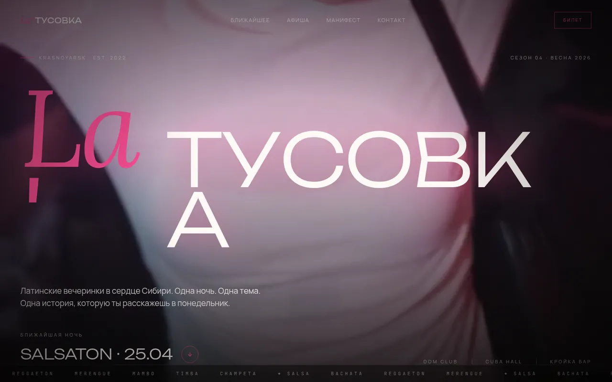
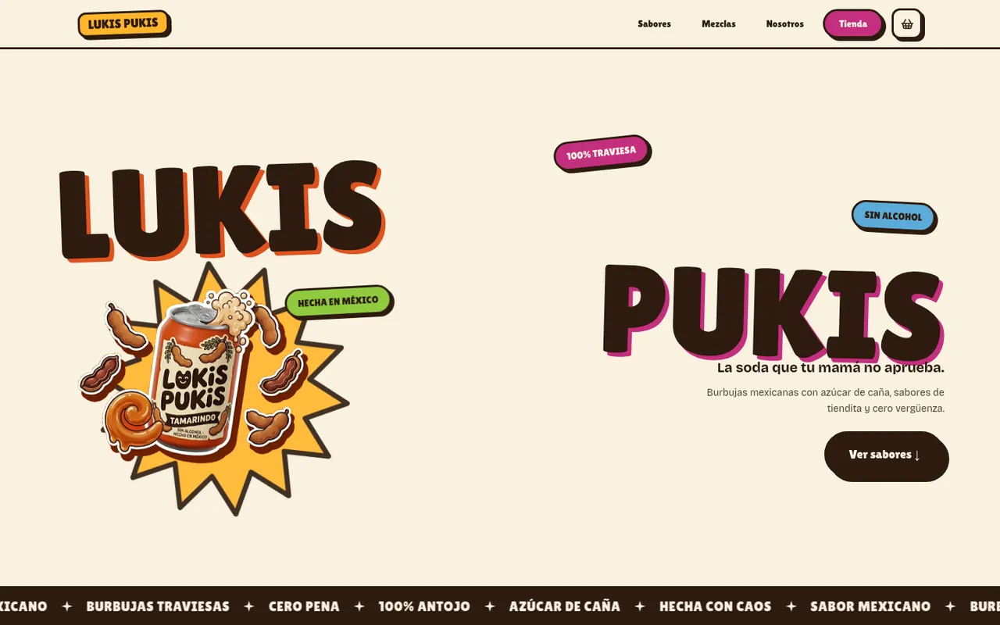
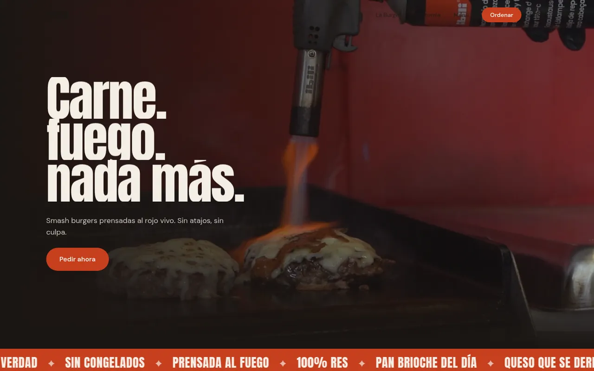
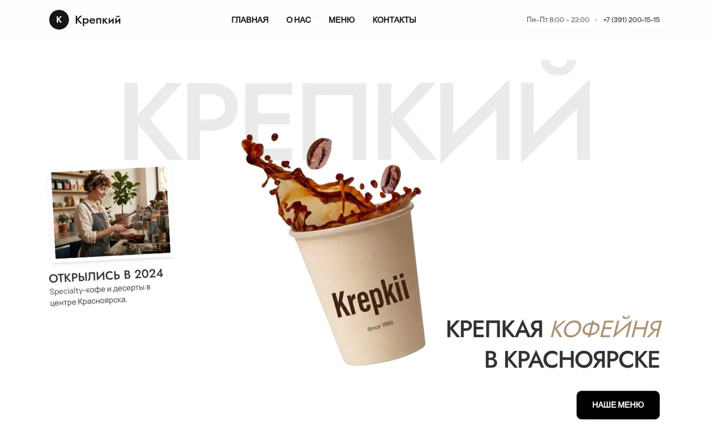
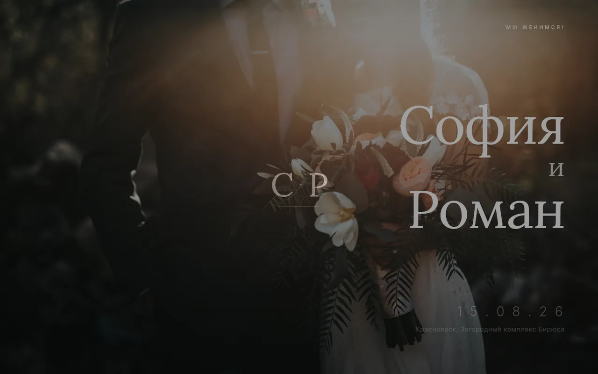

# Websites, on the side

I'm an AI/ML engineer — that's my main path. Building websites is my side craft:
a way to experiment with design, motion and frontend tooling, and to take an idea
all the way to a live page. These are some of the landings I've made along the way.

Each one is a solo project, from idea to deploy.

> Source code is not published here. Each project links to its live version.

## How I work

1. **Concept first.** I start from the brand or the event and pick one visual
   direction to commit to — a mood, a palette, a type pairing.
2. **Design tokens before pages.** Colors, typography and spacing live in one
   place, with fonts that support Cyrillic as well as Latin.
3. **Content apart from code.** Texts, events, menus and photos sit in a single
   content file, so a page can be adapted without touching the components.
4. **Motion with intent.** Scroll and entrance animations are there to tell the
   story, not just to decorate.
5. **Ship it.** Optimized images and video, generated icons and social previews,
   deployed to Cloudflare Pages or Vercel.

## Projects

| | Project |
|---|---|
|  | **La' Tusovka** · 2026 Cinematic landing for a Latin party producer in Krasnoyarsk, built as a pitch demo. Video hero, event countdown, ES/RU rotating quotes, film-grain look. **Stack:** Next.js 16 (static export), React 19, TypeScript, Tailwind CSS 4, Framer Motion, Lenis · Cloudflare Pages 🔗 [Live site](https://la-tusovka.pages.dev) |
|  | **Lukis Pukis** · 2026 Playful landing for a concept Mexican soda brand: flavors, mixes, FAQ and sticker-style illustrations. **Stack:** Next.js 16, React 19, TypeScript, Tailwind CSS 4, GSAP, Framer Motion, Lenis · Cloudflare Pages 🔗 [Live site](https://lukis-pukis.pages.dev) |
|  | **Brasa** · 2026 Landing for a concept smash-burger brand: video hero, a burger that builds itself layer by layer as you scroll, menu and ordering section. **Stack:** Next.js 16, React 19, TypeScript, Tailwind CSS 4, GSAP ScrollTrigger, Framer Motion, Lenis · Cloudflare Pages 🔗 [Live site](https://brasa-e2t.pages.dev) |
|  | **Krepkiy** · 2026 Reusable landing template for small local businesses, shown with demo content for a café. 11 sections and a scroll-driven hero animation. **Stack:** Next.js 16, React 19, TypeScript, Tailwind CSS 4, Framer Motion · Vercel 🔗 [Live site](https://cafe-krepkiy.vercel.app) |
|  | **Lux Wedding** · 2026 Reusable wedding landing template with demo content: editorial typography, gallery with lightbox, map links, i18n-ready. **Stack:** Next.js 16, React 19, TypeScript, Tailwind CSS 4, Framer Motion · Cloudflare Pages 🔗 [Live site](https://lux-wedding.pages.dev) |

---

Main profile: [Lux-Mg](https://github.com/Lux-Mg) — AI/ML engineering.
